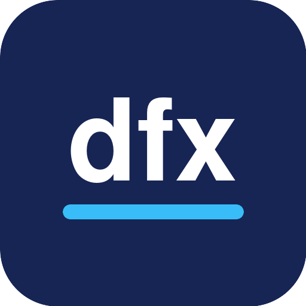

# dfx

This is the development branch of dfx 1.0.

> **NOTE: This branch is undergoing development. It has incomplete code, functionality, and design that are likely to change without notice; when using TorchSharp backend, only x64 platform is currently supported out of the box, see [DEVGUIDE.md] for more details.**

## From DiffSharp to dfx

dfx is the continuation of [DiffSharp](https://github.com/DiffSharp/DiffSharp). We are deeply grateful to DiffSharp's creators, maintainers, contributors, and community, whose ideas, care, and many years of work made this project possible. In particular, we offer our sincere thanks to [Dr. Atılım Güneş Baydin](https://www.cs.ox.ac.uk/people/atilim.gunes.baydin/) for creating and leading DiffSharp and for his foundational contributions to differentiable programming in F#.

dfx is a tensor library with support for [differentiable programming](https://en.wikipedia.org/wiki/Differentiable_programming). It is designed for use in machine learning, probabilistic programming, optimization and other domains.

**Key features**

* Nested and mixed-mode differentiation
* Common optimizers, model elements, differentiable probability distributions
* F# for robust functional programming
* PyTorch familiar naming and idioms, efficient LibTorch CUDA/C++ tensors with GPU support
* Linux, macOS, Windows supported
* Use interactive notebooks in Jupyter and Visual Studio Code
* 100% open source

## Documentation

You can find the documentation at [docs.dfx.ac](https://docs.dfx.ac/), including information on installation and getting started.

Release notes can be found [here](https://github.com/dfx-org/dfx/blob/main/RELEASE_NOTES.md).

## Communication

Please use [GitHub issues](https://github.com/dfx-org/dfx/issues) to share bug reports, feature requests, installation issues, suggestions etc.

## Contributing

We welcome bug reports, feature requests and ideas. Please [open an issue](https://github.com/dfx-org/dfx/issues/new/choose) rather than a pull request; see [CONTRIBUTING.md](CONTRIBUTING.md) for details.

## The Team

dfx carries forward [DiffSharp](https://github.com/DiffSharp/DiffSharp), which was developed by [Dr. Atılım Güneş Baydin](https://www.cs.ox.ac.uk/people/atilim.gunes.baydin/), [Don Syme](https://www.microsoft.com/en-us/research/people/dsyme/) and other contributors, having started as a project supervised by the automatic differentiation wizards [Barak Pearlmutter](https://scholar.google.com/citations?user=AxFrw0sAAAAJ&hl=en) and [Jeffrey Siskind](https://scholar.google.com/citations?user=CgSBtPYAAAAJ&hl=en).

## License

dfx is licensed under the BSD 2-Clause "Simplified" License, which you can find in the [LICENSE](https://github.com/dfx-org/dfx/blob/main/LICENSE) file in this repository.
